<p align="center">
  
</p>

<p align="center">
  <a href="https://github.com/SirAseef/heatflood-sentinel/actions/workflows/ci.yml"></a>
  
  <a href="LICENSE"></a>
  
  
  
  
  
  
</p>

# HeatFlood Sentinel

**Scalable Big Data and Deep Learning Framework for Heatwave and Flash-Flood Forecasting and Detection in Pakistan**
— the software artefact of an MS Data Science thesis at NED University of Engineering and Technology, Karachi.

## Abstract

Pakistan faces recurring extreme heat (Jacobabad, upper Sindh) and monsoon flash floods, yet operational early-warning
research rarely combines streaming infrastructure, deep sequence models and honest benchmarking in one reproducible
system. HeatFlood Sentinel ingests **real ERA5 reanalysis** for 20 Pakistani cities (hourly, 2015–2022) and a 2°
national grid, builds quality-controlled medallion layers with train-only climatologies, and benchmarks **LSTM and
ConvLSTM** against **SARIMA, XGBoost**, persistence and climatology for 2 m temperature and precipitation at
hourly (+1/+6/+24 h) and daily (1–7 d) leads, with Diebold–Mariano tests, block-bootstrap CIs and Holm correction on
the held-out year 2022. Calibrated XGBoost and CNN detectors flag heatwaves (percentile definition) and a
flash-flood-risk proxy; a shared micro-batch stream processor (local runtime, Kafka and Spark adapters) drives a
severity-levelled alert engine with hysteresis, exercised under seven chaos scenarios, and a FastAPI service with a
10-page dashboard and a live Open-Meteo feed. Results are mixed and reported as such: LSTM is the best or tied-best
hourly temperature model and significantly beats persistence for daily Tmax from lead 3 d, SARIMA is hard to beat
for daily Tmax, climatology wins daily precipitation beyond 1 d, and simple rule persistence remains the strongest
heatwave detector at 1-day lead. On the 2° grid the ConvLSTM beats persistence and climatology at every
lead from +1 to +6 h.

## Architecture

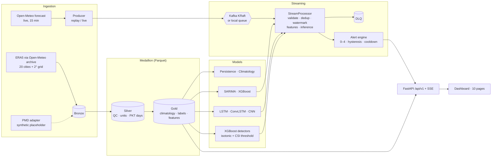

More detail: [docs/architecture.md](docs/architecture.md).

## Dashboard

| | |
|---|---|
| **Command Center** <br/> 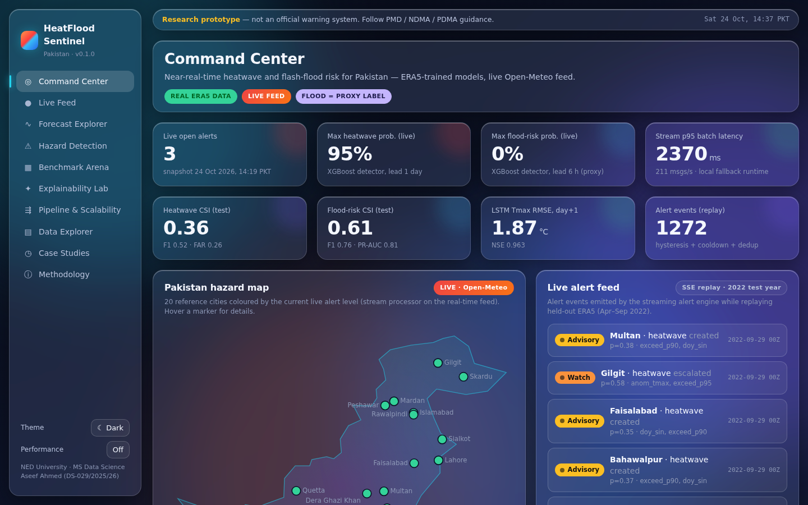 | **Live Feed** <br/> 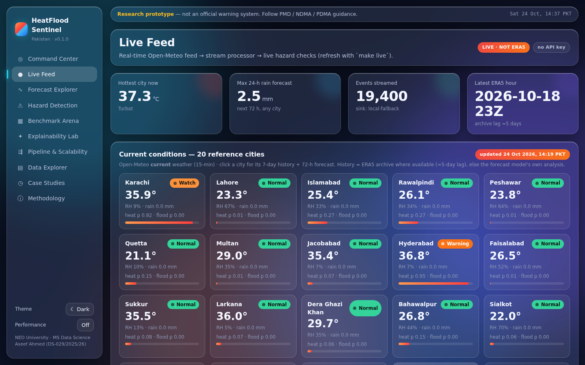 |
| **Forecast Explorer** <br/> 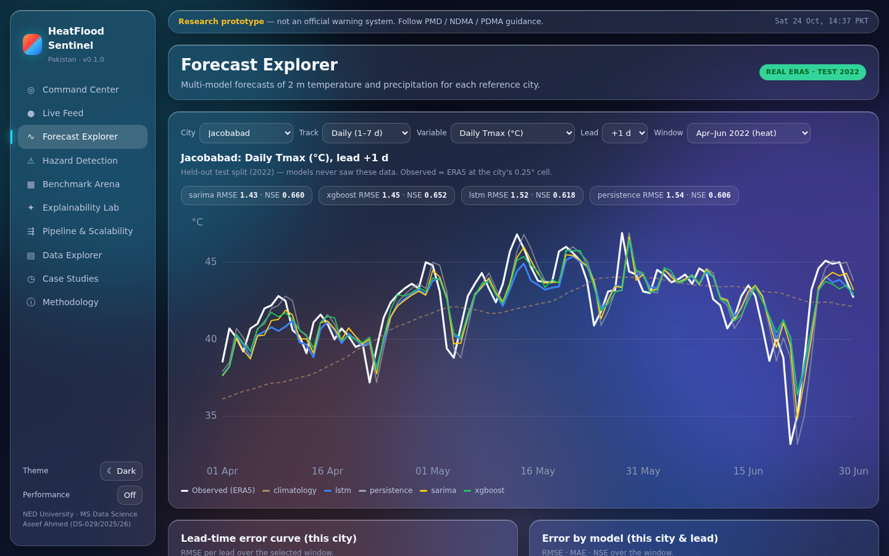 | **Hazard Detection** <br/> 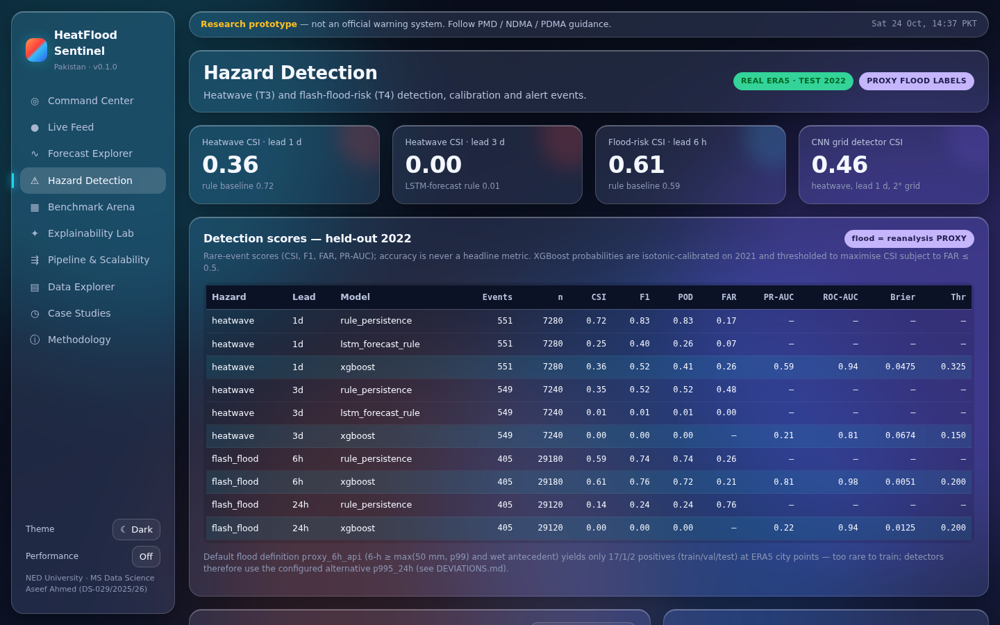 |
| **Benchmark Arena** <br/> 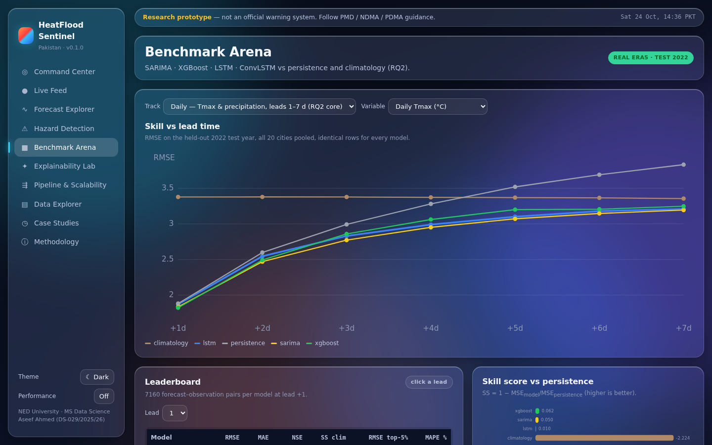 | **Explainability Lab** <br/> 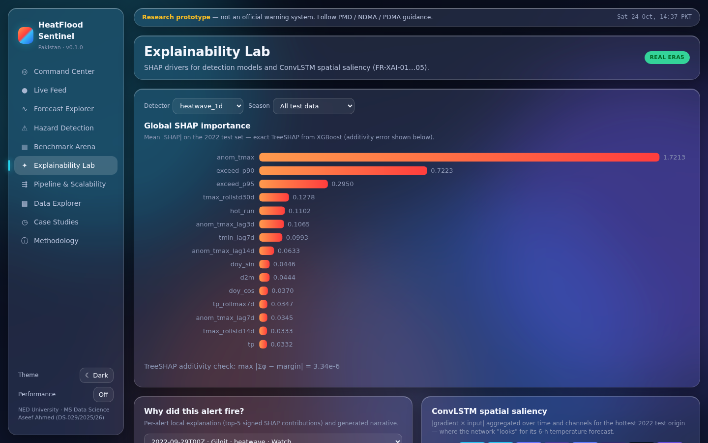 |
| **Pipeline & Scalability** <br/> 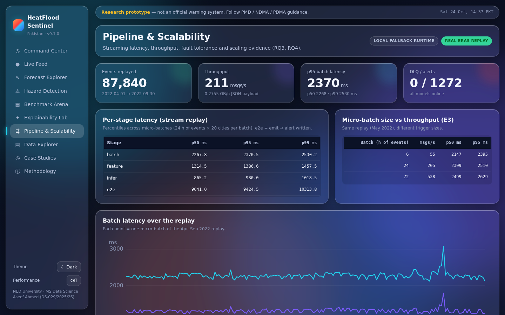 | **Case Studies** <br/> 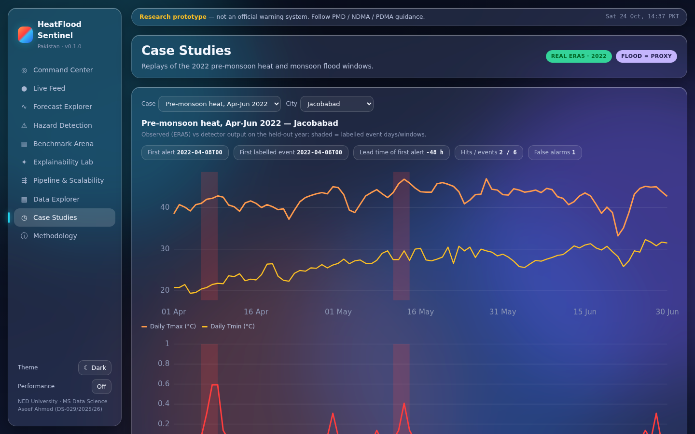 |
| **Data Explorer** <br/> 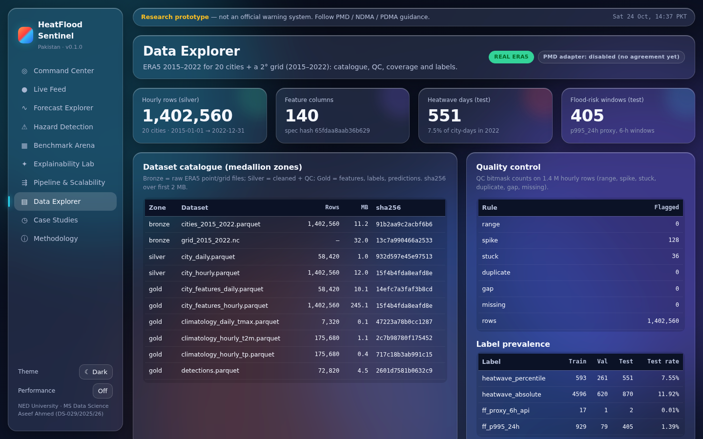 | **Methodology** <br/> 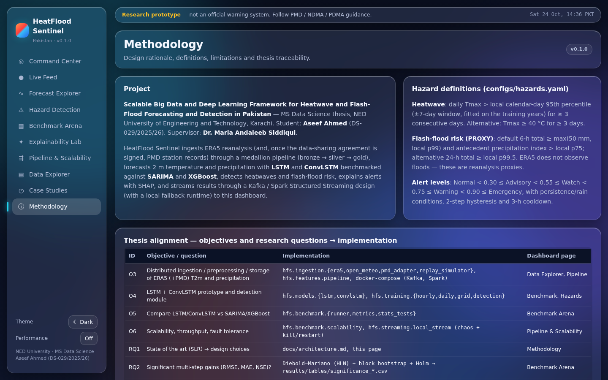 |

Full-page captures: `docs/screenshots/*_full.png`.

## Quickstart

```bash
git clone https://github.com/SirAseef/heatflood-sentinel.git && cd heatflood-sentinel
make setup          # pip install -r requirements-dev.txt, create .env
make reproduce      # real ERA5 download → features → train → benchmark → stream → live → scale → report
make api            # FastAPI + dashboard on http://127.0.0.1:8000  (OpenAPI docs at /docs)
make test           # unit + integration tests on synthetic data (no network)
```

Docker (Kafka KRaft + API + producers + stream consumer; add Spark with `make up-full`):

```bash
make up             # docker compose --profile dev-lite up -d --build
make down
```

Individual stages: `make data features train-hourly train-daily train-grid detect benchmark stream live scale report screenshots`.
Optional: `make tune` (Optuna, validation year only), `make data-cds` (full 0.25° ERA5 from Copernicus).
See [docs/reproducibility.md](docs/reproducibility.md).

## Results (held-out test year 2022)

All numbers below are copied from [`results/RESULTS.md`](results/RESULTS.md), which `make report` generates from run
artefacts. **Bold** = best in its block. Rows where a baseline wins are kept on purpose.

### Hourly 2 m temperature (°C RMSE, 20 cities)

| Lead | LSTM | XGBoost | Persistence | Diurnal persistence | Climatology |
|---:|---:|---:|---:|---:|---:|
| +1 h | **0.634** | 0.679 | 1.558 | 1.937 | 2.878 |
| +6 h | **1.372** | 1.469 | 5.783 | 1.938 | 2.878 |
| +24 h | **1.756** | 1.779 | 1.938 | 1.938 | 2.878 |

Hourly precipitation (mm/h RMSE): LSTM 0.262 / 0.382 / 0.398 vs persistence 0.278 / 0.472 / 0.526 and
climatology 0.403 at +1 / +6 / +24 h; at +1 h XGBoost (0.279) is slightly *worse* than persistence.

### Daily Tmax (°C RMSE)

| Lead | SARIMA | LSTM | XGBoost | Persistence | Climatology |
|---:|---:|---:|---:|---:|---:|
| 1 d | 1.834 | 1.871 | **1.822** | 1.881 | 3.377 |
| 3 d | **2.772** | 2.831 | 2.859 | 2.992 | 3.378 |
| 7 d | **3.194** | 3.209 | 3.248 | 3.832 | 3.355 |

Significance (Diebold–Mariano, block bootstrap, Holm): at lead 1–3 d **SARIMA significantly beats LSTM**; LSTM is
**not** significantly better than persistence at 1–2 d, but significantly better from 3 d to 7 d
(e.g. −0.62 °C RMSE at 7 d, p_holm < 0.001); LSTM beats XGBoost at 4–5 d; LSTM vs SARIMA is a tie from 4 d on.

### Daily precipitation (mm RMSE) — climatology is hard to beat

| Lead | SARIMA | LSTM | XGBoost | Persistence | Climatology |
|---:|---:|---:|---:|---:|---:|
| 1 d | **5.656** | 5.677 | 5.697 | 6.346 | 5.841 |
| 3 d | 5.996 | 5.946 | 5.994 | 7.566 | **5.840** |
| 7 d | 5.809 | 5.756 | 5.827 | 7.642 | **5.652** |

LSTM is significantly better than SARIMA and XGBoost for daily precipitation at 3–7 d, but **all learned models are
worse than climatology beyond 1 day** (NSE ≤ 0.05).

### Gridded ConvLSTM (2° lattice, 7 × 8 cells, RMSE)

| Lead | ConvLSTM t2m (°C) | Persistence | Climatology | ConvLSTM tp (mm/h) | Persistence | Climatology |
|---:|---:|---:|---:|---:|---:|---:|
| +1 h | **1.262** | 1.600 | 3.220 | **0.226** | 0.229 | 0.375 |
| +2 h | **1.645** | 2.645 | 3.220 | **0.289** | 0.318 | 0.375 |
| +3 h | **1.770** | 3.585 | 3.220 | **0.316** | 0.366 | 0.375 |
| +4 h | **1.999** | 4.567 | 3.220 | **0.330** | 0.398 | 0.375 |
| +5 h | **2.121** | 5.415 | 3.220 | **0.339** | 0.423 | 0.375 |
| +6 h | **2.287** | 6.171 | 3.220 | **0.345** | 0.440 | 0.375 |

Retrained for v0.1.0 with denser training origins (every 3 h, 17.5 k samples) and early stopping on 2021
(best epoch 3 of 6, val loss 0.2193 vs 0.2725 for the earlier 4-epoch model). The earlier model was *worse* than
persistence for t2m at +1 to +4 h (e.g. 1.956 vs 1.600 °C at +1 h); the retrained one beats persistence and
climatology at every lead. Precipitation skill over persistence is small at +1 h (NSE 0.65 vs 0.64) and the
precipitation RMSE moved by < 0.004 mm/h between the two models. Coarse 2° grid, so these are not station-scale numbers.

### Hazard detection

| Hazard | Lead | Model | CSI | F1 | POD | FAR | PR-AUC |
|---|---|---|---:|---:|---:|---:|---:|
| Heatwave | 1 d | **Rule persistence** | **0.717** | **0.835** | 0.835 | 0.165 | – |
| Heatwave | 1 d | XGBoost (calibrated) | 0.356 | 0.525 | 0.407 | 0.261 | 0.589 |
| Heatwave | 1 d | LSTM forecast + rule | 0.253 | 0.404 | 0.258 | 0.066 | – |
| Heatwave | 3 d | **Rule persistence** | **0.348** | **0.516** | 0.517 | 0.485 | – |
| Heatwave | 3 d | XGBoost | 0.000 | 0.000 | 0.000 | – | 0.209 |
| Heatwave (grid) | 1 d | CNN | 0.465 | 0.634 | 0.650 | 0.381 | 0.640 |
| Heatwave (grid) | 1 d | **Rule persistence** | **0.686** | **0.813** | 0.813 | 0.187 | – |
| Flood proxy | 6 h | **XGBoost** ⚠ | **0.609** | **0.757** | 0.723 | 0.206 | 0.814 |
| Flood proxy | 6 h | Rule persistence | 0.585 | 0.738 | 0.738 | 0.262 | – |
| Flood proxy | 24 h | **Rule persistence** | **0.136** | **0.240** | 0.240 | 0.760 | – |
| Flood proxy | 24 h | XGBoost | 0.000 | 0.000 | 0.000 | – | 0.216 |

⚠ The 6-h flood target shares 18 of 24 hours with an input feature (see [DEVIATIONS.md](DEVIATIONS.md) D1);
treat it as detection/nowcasting, not forecasting. Flood labels are an ERA5 rainfall-extreme **proxy**.

### Streaming and scalability (local runtime, 2 vCPU)

| Metric | Value |
|---|---|
| Replay window | 2022-04-01 … 2022-09-30, 87,840 events, 183 daily micro-batches |
| Throughput | 211 msgs/s (0.276 GB/h) |
| Micro-batch latency p50 / p95 / p99 | 2,268 / 2,370 / 2,530 ms |
| Event-time → alert latency p50 / p95 / p99 | 9.0 / 9.4 / 10.3 s |
| Alerts / DLQ (clean run) | 1,272 / 0 |
| Chaos: duplicates, out-of-order, kill-restart | alert stream identical to baseline, 0 duplicate alerts |
| Chaos: corrupt, delayed, missing, 3-day outage | corrupt/late events routed to DLQ (333 / 299); 0 duplicate alerts; alert count 383 / 383 / 383 / 342 vs 384 |
| Batch feature throughput ×1 / ×2 / ×4 volume | 75.9 k / 83.4 k / 89.8 k rows/s |
| 2 workers vs 1 | speed-up 1.88, efficiency 0.94 |

### Live snapshot (real time, 2026-10-24)

The live feed streams the last 40 days (ERA5 where available, bias-corrected Open-Meteo NWP otherwise) through the
same processor. After the NWP→ERA5 bias fix (DEVIATIONS.md D3) the snapshot shows heatwave **Warning for Hyderabad**,
**Watch for Karachi** and **Advisory for Turbat** (anomalously warm late-October spell relative to the local
calendar-day p95; not a heatwave under an absolute 40 °C rule) and no alerts elsewhere.

## Thesis alignment

| Objective / RQ | Question | Modules | Evidence in this repo |
|---|---|---|---|
| O1–O2 / **RQ1** | State of the art in big data + ML for T2m/precipitation and hazard detection in South Asia | Methodology page (`web/about.html`), thesis SLR | Systematic literature review (separate thesis chapter); design choices traced in SRS |
| **O3** | Distributed pipeline to ingest, preprocess, store ERA5 (+PMD) | `hfs.ingestion`, `hfs.features`, `hfs.storage`, `docker-compose.yml` | 1.40 M hourly rows QC'd into bronze/silver/gold; Kafka/Spark adapters provided (not executed, D6) |
| **O4** | LSTM / ConvLSTM prototype + heatwave & flash-flood classifiers | `hfs.models`, `hfs.training` | LSTM (hourly, daily ×3 seeds), ConvLSTM grid, CNN + XGBoost detectors |
| **O5** / **RQ2** | Do LSTM/ConvLSTM give significant multi-step gains over SARIMA/XGBoost? | `hfs.benchmark.runner`, `stats_tests` | Hourly: LSTM best at all leads. Daily Tmax: SARIMA ≥ LSTM at 1–3 d (significant), tie after; LSTM ≫ persistence from 3 d. Precip: LSTM > SARIMA/XGB at 3–7 d but < climatology. ConvLSTM (2° grid) beats persistence and climatology for t2m and precipitation at +1…+6 h. NWP comparison not run (D7) |
| **RQ3** | Can streaming achieve near-real-time detection? | `hfs.streaming.*` | p95 event→alert 9.4 s on daily micro-batches; 0 DLQ clean; detection CSI/F1/FAR table above |
| **O6** / **RQ4** | Scalability, throughput, fault tolerance vs volume/config | `hfs.benchmark.scalability`, `local_stream` chaos | Near-linear volume scaling, 0.94 2-worker efficiency, 7 chaos scenarios with exactly-once alerts; cluster scaling not measured (D6) |

## What ran where

| Component | Status |
|---|---|
| Real data | **ERA5 via the Open-Meteo archive** (`models=era5`) — every reported number |
| Local fallback runtime | **Executed**: features, all training, benchmark, full stream replay + chaos, scalability, live feed, report, screenshots |
| Kafka (KRaft) + Spark Structured Streaming | Provided via `docker compose` (`make up`, `make up-full`); **not executed in the sandbox** (no Docker daemon); CI builds the image |
| Live feed | Executed against Open-Meteo; primary host hit its daily quota, fallback `previous-runs-api.open-meteo.com` used |
| PMD station adapter | Implemented; **synthetic placeholder** input only |
| Starter `.nc` files | **Synthetic** ERA5-like fields, used only for tests / offline demo, never for results |
| Copernicus CDS full-resolution ERA5 | Scripted (`make data-cds`), not run |

## Repository layout

```
configs/      app, cities, hazards, alerts, features, models (YAML)
src/hfs/      ingestion · features · storage · models · training · benchmark · streaming · api · common
web/          dashboard (10 static pages, vanilla JS)
tests/        unit + integration (synthetic data)
results/      RESULTS.md, tables/*.csv, latex/*.tex, figures/*.png, run records (*.json)
docs/         architecture · data · models · evaluation · reproducibility · screenshots
infra/        Dockerfiles, Spark submit script
scripts/      data download/preprocess, synthetic sample, screenshots, tune_xgb
```

## Citation

```bibtex
@mastersthesis{ahmed2026heatflood,
  author = {Aseef Ahmed},
  title  = {Scalable Big Data and Deep Learning Framework for Heatwave and Flash-Flood Forecasting and Detection in Pakistan},
  school = {NED University of Engineering and Technology, Karachi},
  year   = {2026},
  type   = {MS Data Science thesis},
  note   = {Software: HeatFlood Sentinel v0.1.0, https://github.com/SirAseef/heatflood-sentinel}
}
```

See also [CITATION.cff](CITATION.cff). ERA5: Hersbach, H. et al. (2020), *The ERA5 global reanalysis*, QJRMS 146,
1999–2049. Weather data by [Open-Meteo.com](https://open-meteo.com/) (CC BY 4.0).

## Author

**Aseef Ahmed** — MS Data Science, NED University of Engineering and Technology, Karachi
Supervisor: **Dr. Maria Andaleeb Siddiqui**
GitHub [@SirAseef](https://github.com/SirAseef) · [LinkedIn](https://www.linkedin.com/in/aseef-ahmed-6ab6b7196)

## License

[MIT](LICENSE) © 2026 Aseef Ahmed. Data remain under their own licences (ERA5: Copernicus licence; Open-Meteo: CC BY 4.0).

Contributions: see [CONTRIBUTING.md](CONTRIBUTING.md) · changes: [CHANGELOG.md](CHANGELOG.md) · caveats: [DEVIATIONS.md](DEVIATIONS.md).
