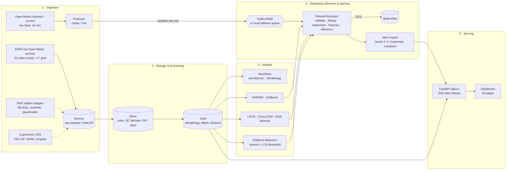

# Architecture

HeatFlood Sentinel follows the five-layer design of the SRS (§4): ingestion → storage/processing → modelling →
streaming inference & alerting → serving. Every runtime (local fallback, Kafka consumer, Spark `foreachBatch`) calls
the **same** `StreamProcessor` and the **same** feature library used for batch training, so training and serving
features cannot drift apart (train–serve parity).

## Modules (`src/hfs`)

| Package | Responsibility |
|---|---|
| `ingestion` | `open_meteo` (ERA5 archive, cities + grid), `era5` (CDS), `pmd_adapter`, `replay_simulator`, `fault_injector`, `validators` |
| `features` | unit conversion, QC bitmask, calendar-day climatology (train-only), hazard labels, lags/rolling windows, `pipeline` (bronze → silver → gold) |
| `models` | baselines, SARIMA (Fourier seasonality), XGBoost forecaster/classifier, LSTM, ConvLSTM (in-house cell), isotonic calibration |
| `training` | hourly, daily and grid tracks, detection, time-only splits |
| `benchmark` | metrics (RMSE/MAE/NSE/skill, CSI/POD/FAR, PR-AUC, Brier), Diebold–Mariano + block bootstrap + Holm, scalability harness, report generator |
| `streaming` | `processor` (shared micro-batch logic), `alert_engine`, `local_stream` (replay + chaos), `kafka_consumer`, `producer`, `spark_stream`, `live_feed`, `latency` |
| `api` | FastAPI app, read-only data access, token auth for ack/refresh |
| `common` | config loader, schemas (pydantic `ObsEvent`), PKT time helpers, structured logging |

## Stream processing contract

Per micro-batch: schema/range validation (pydantic) → DLQ; dedup by deterministic `event_id` (UUIDv5 of
city|time) within a 2-h watermark; late events beyond the watermark → DLQ; per-entity 36-day buffers; features from
`hfs.features.pipeline`; heatwave evaluation once per completed PKT day (lead 1 d); flash-flood evaluation at the
end of each 6-h window; XGBoost t2m +6/+24 h forecasts; alert engine; per-stage latency stamps. Checkpoint/restore
covers dedup keys, buffers, open alerts and evaluated keys (exactly-once alert emission on restart, verified by the
`kill_restart` chaos scenario).

## Alert engine

Probability → level: Advisory ≥ 0.30, Watch ≥ 0.55, Warning ≥ 0.75, Emergency ≥ 0.90 (`configs/alerts.yaml`).
Heatwave Warning additionally needs ≥ 2 consecutive hot days and Emergency ≥ 3; flood Emergency needs ≥ 100 mm/6 h.
Escalation is immediate, de-escalation needs 2 consecutive lower evaluations, same-level re-notification waits 3 h.

## Deployment profiles

* **dev-lite (executed):** single process, local fallback queue, Parquet medallion, FastAPI + static dashboard.
* **docker compose (`make up`, provided, not executed in the sandbox):** Kafka 3.7 KRaft, topic provisioning, API,
  replay + live producers, Python stream consumer; `make up-full` adds Spark 3.5 master/worker and the Structured
  Streaming job (`infra/spark/submit.sh`).
